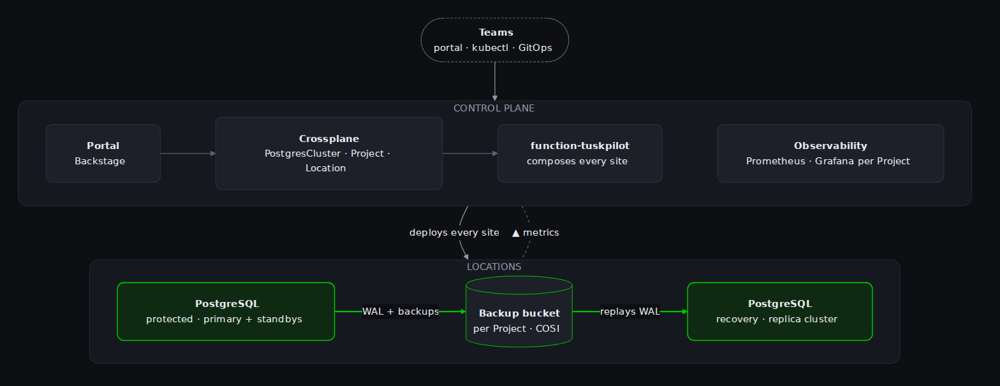

# Tuskpilot

Tuskpilot is PostgreSQL as a service on Kubernetes, built on
[CloudNativePG](https://cloudnative-pg.io/) (CNPG), [Crossplane](https://www.crossplane.io/) and
[Backstage](https://backstage.io/). Teams order production-ready PostgreSQL clusters themselves,
through this portal or the Kubernetes API, and the platform runs them.

## What you get

- **Self-service:** one `PostgresCluster` object, or the **New cluster** form, gives you a highly
  available cluster in a size from the platform's catalog (XS to XL), with PostgreSQL tuned to it.
- **AI workloads:** the **Vector & RAG** profile (PostgreSQL 18) brings pgvector, VectorChord for
  large vector indexes and pg_search for BM25 and hybrid search. See [Vector & RAG](clusters/vector-rag.md).
- **Projects:** each team works in its own Project, with access control, an optional quota and
  deletion protection, and its own Prometheus and Grafana.
- **Observability:** metrics, alerts and a CloudNativePG dashboard for every cluster, in your
  Project's Grafana.
- **Backups and resilience:** continuous backups to object storage, point-in-time restore into a new
  cluster, and a replica cluster in a second location that can take over.

## How it fits together

{ width="784" }

<!-- Source: diagrams/architecture.mmd; ../render-diagrams.sh renders it. -->

- The **control plane** runs the APIs (Crossplane) and the portal, but no databases.
- **Locations** are the Kubernetes clusters the databases run in.
- A **Project** has a **protected** location, where its databases run, and optionally a **recovery**
  location for replica clusters. The replica is fed through the Project's backup bucket, so the two
  locations need no network path to each other.

## Where to go next

| I want to | Read |
|---|---|
| Create my first database | [Getting started](getting-started.md) |
| Pick a size, extensions, HA or pooling | [Configure a cluster](clusters/configure.md) |
| Store embeddings and build RAG search | [Vector & RAG](clusters/vector-rag.md) |
| Move the primary to the other location | [Geo replication and disaster recovery](clusters/disaster-recovery.md) |
| Restore to a point in time | [Backups and restore](clusters/backup-restore.md) |
| Automate it (GitOps, CI) | [API reference](api.md) |
| Run the platform | [Architecture](platform/architecture.md), [Install](platform/install.md), [Catalogs](platform/catalogs.md), [Upgrades](platform/upgrades.md) |
| Find out what's wrong | [Troubleshooting](platform/troubleshooting.md), [Monitoring](platform/monitoring.md) |
